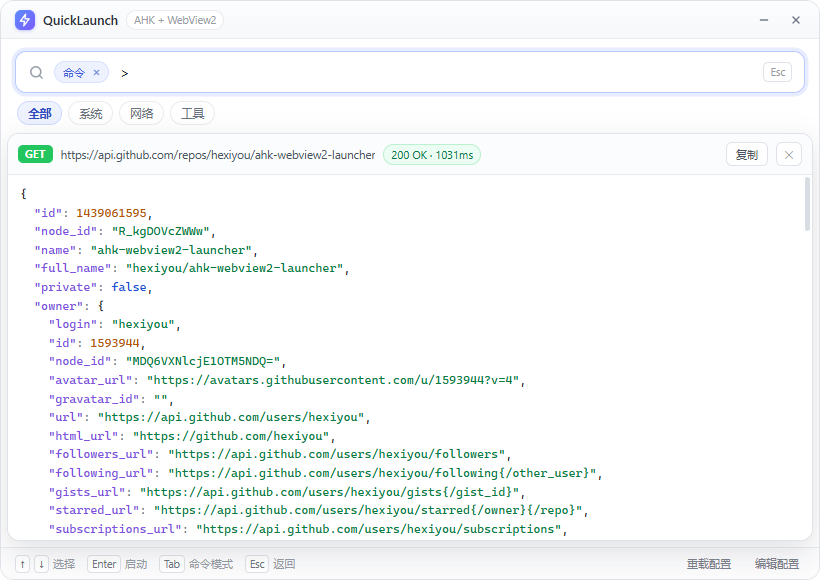
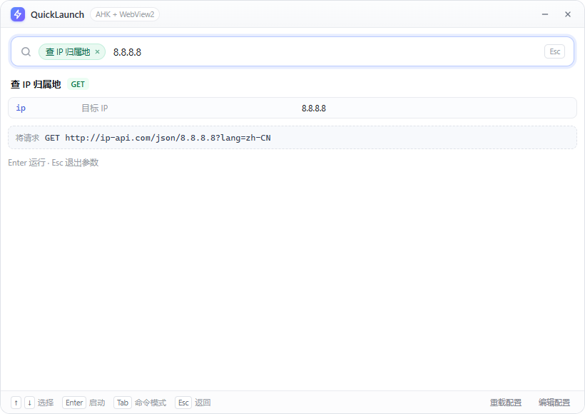
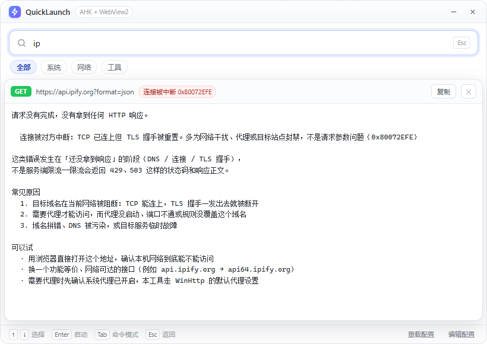

# QuickLaunch — AutoHotkey v2 + WebView2 快速启动器

用 AutoHotkey 做壳、用 HTML/CSS/JS 做界面、用 WebView2 做渲染引擎的 uTools 式快速启动器。
本项目的用途是**验证「AHK + WebView2 开发小工具」这条链路是否真的可行**，所以功能刻意做得小、
但链路是完整的（无边框窗口、外部配置、搜索、图标、全局热键、JS↔AHK 双向通信）。


> 分组胶囊 + `>` 命令模式 + webhook 响应面板（真实 GitHub API 返回，JSON 自动着色）：
>
> 

---

## 一、结论

**可行，而且很成熟。**

### 1. AutoHotkey 能引用 WebView2 吗？

能。但**不能用 `Gui.AddActiveX` 那种方式**——WebView2 不是注册到 COM 的 ActiveX/OCX 控件，
系统里没有它的控件类。它对外只暴露一组「非注册」的 COM 接口，必须走这条路：

```
WebView2Loader.dll
  └─ CreateCoreWebView2EnvironmentWithOptions()      → ICoreWebView2Environment
       └─ CreateCoreWebView2Controller(hwnd)         → ICoreWebView2Controller（把浏览器合成到你的窗口上）
            └─ get_CoreWebView2()                    → ICoreWebView2（Navigate / ExecuteScript / WebMessage…）
```

AHK 靠 `DllCall` + 手写 COM vtable 索引就能完成全部调用，没有任何"底层做不到"的地方。
本项目直接使用社区库 [thqby/ahk2_lib · WebView2](https://github.com/thqby/ahk2_lib/tree/master/WebView2)（MIT），
它已经把 2000 多行 COM 接口定义封装好了，目录里已内置，开箱即用。

**两个前置条件**（缺一不可）：

| 依赖 | 说明 |
|---|---|
| WebView2 Runtime | Win11 自带；Win10 装过新版 Edge 一般就有。缺了去微软官网装 Evergreen Runtime |
| `lib\WebView2Loader.dll` | 微软 SDK 里的加载器，**位数必须和 AHK 一致**（本项目用 64 位 AHK → `x64` 的 dll） |

### 2. 四条需求逐条结论

| 需求 | 结论 | 实现方式 |
|---|---|---|
| ① 无边框 + 网页 UI | ✅ 可行 | `Gui('-Caption +ToolWindow')` + `SetWindowRgn` 圆角 + 页面自绘标题栏；拖拽用 WebView2 原生非客户区支持（`IsNonClientRegionSupportEnabled` + CSS `-webkit-app-region: drag`），由系统移动循环搬窗口 |
| ② 外部配置数据源 | ✅ 可行 | 条目全在 `config.json`（名称/关键词/图标/类型/路径/参数/置顶）；AHK 侧设置放 `launcher.ini` |
| ③ 搜索框 + 常用卡片 | ✅ 可行 | 纯前端实现：输入即时过滤 + `↑↓` 选择 + `Enter` 启动 + 置顶卡片 |
| ④ 全局热键呼出 | ✅ 可行 | `Hotkey()` 动态注册，热键写在 ini 里，改配置即换键 |

### 3. 本机实测结果

环境：Windows 10 19045 / Edge WebView2 Runtime 156.0.4314.50 / AutoHotkey v2.0.31（64 位）

| 验证项 | 结果 |
|---|---|
| WebView2 控制器创建、内核版本读取 | ✅ `156.0.4314.50` |
| 无边框窗口 + 圆角 + 页面渲染 | ✅ 见截图 |
| JS → AHK（`postMessage`） | ✅ 收到 `ready` / `icons` / `run` |
| AHK → JS（`PostWebMessageAsJson`） | ✅ 图标映射回传成功 |
| 从 exe 自动提取图标（GDI+ 转 PNG） | ✅ 记事本/cmd/PowerShell/画图/资源管理器 均为真实图标 |
| 页面搜索过滤 | ✅ 输入 `pow` → 只剩 PowerShell |
| 拼音 / 首字母 / 跳字模糊 | ✅ `jsb`、`jishiben` → 记事本；`npad` → 记事本（`node tests/search.test.js` 58 条全绿） |
| 参数态 `Tab` 补目录 | ✅ 真窗口里输入 `C:\Win` 按 Tab → `C:\Windows\` |
| 参数态 `→` 补历史 | ✅ 先跑一次 `8.8.8.8`，再输入 `8.8` 按 `→` → `8.8.8.8` |
| 使用频率落盘 | ✅ `usage.json` 出现 `{"http-geo":{"n":1,...}}`，空查询时该条目排到第一 |
| UNC 共享上的 exe / bat / 图标 / 参数 | ✅ 真去 `\\localhost\…` 跑（`node tools/unc-check.js`），见「局域网共享」一节 |
| 下载二进制文件 | ✅ 本地起 HTTP 服务，286 字节二进制**逐字节一致**（含全部 256 种字节值 + 中文）；`skip`/`overwrite`/`.bak`/404 全按预期（`node tools/dl-check.js` 14 项） |
| 拉取在线配置 | ✅ 拉到正常 JSON 会替换并留 `.bak`；拉到 HTML 错误页会拒绝覆盖（同一脚本 T8/T9） |
| 点击条目 → 真的启动程序 | ✅ 通过 `cmd /c echo ok>…` 生成了目标文件 |
| 全局热键 `Ctrl+Alt+Space` 显隐 | ✅ 用 `keybd_event` 模拟真实按键，窗口 visible 1→0→1 |

> 后面几项不是"看起来对"，是 `node tools/e2e.js` 用真窗口、真 WebView2、真 AHK 桥接跑出来的
> （18 步，日志见 `_e2e.log`，跑完自动退出）。UNC 那几项由 `node tools/unc-check.js` 单独跑，
> 它会真的启动共享上的进程；下载那两项由 `node tools/dl-check.js` 跑，自己起本地 HTTP 服务，
> 不联网、不碰仓库里的文件。

---

## 二、跑起来

```
双击 run.bat
```

- 想从终端用，用同目录的 `ql.cmd`（`ql run 记事本` 之类），见「六、命令行」。把项目目录
  加进 `PATH` 之后就能在任何地方直接敲 `ql`。
- 项目自带免安装的 AHK v2 运行时（`runtime\AutoHotkey64.exe`），不装 AHK 也能直接跑；
  如果你本机已装 AutoHotkey v2，`run.bat` 找不到 runtime 时会用系统关联打开 `launcher.ahk`。
- 首次运行会生成 `.webview2\` 目录（WebView2 的缓存/用户数据，可随时删）。

### 操作与退出

| 操作 | 结果 |
|---|---|
| `Ctrl+Alt+Space` | 全局显隐（热键由 `launcher.ini` 的 `Hotkey` 决定） |
| 输入关键词 | 实时过滤（拼音 / 拼音首字母 / 跳字模糊都能命中）；`↑` `↓` 选择，`Enter` 启动 |
| `>` 开头 | **命令模式**：只搜 `cmd` / `ahk` / `webhook` / `download` 这几类「动作」条目 |
| `@分组` | 只看某个分组；支持前缀匹配（`@n` 命中 `net`），`term` 为空就是列出整组 |
| `@net>ip` | 分组 + 命令模式，可叠加 |
| `Tab` | 非参数态：在当前范围里开关命令模式（`ip` ⇄ `>ip`，`@net ip` ⇄ `@net>ip`） |
| **条目名后打空格** | 进入**参数态**：后面输入的内容是本次运行的参数（见下方「运行时参数」） |
| 参数态 `→` | 用最近一次的历史把当前前缀补全（`8.8` → `8.8.8.8`） |
| 参数态 `Tab` | 路径类参数补目录（`C:\Win` → `C:\Windows\`） |
| 点分组胶囊 | 等价于输入 `@分组`，会自动保留关键词与命令模式 |
| 底部「拉取在线配置」 | 弹层里填网址，下载远端 `config.json` 覆盖本地（先校验再替换，原文件留 `.bak`），见「拉取在线配置」 |
| `Esc` | 逐层退：关结果面板 → 退出参数态 → 清空查询 → 隐藏窗口 |
| 标题栏 `—` / `✕` | **只隐藏，不退出**（否则全局热键就唤不出来了） |
| 托盘图标右键 | 编辑配置 / 重载配置 / 重启软件 / 退出软件 |
| 托盘 → 退出软件 | **唯一真正退出程序的入口** |

> 程序是靠托盘常驻的：关掉窗口只是隐藏，热键随时能唤回；想彻底关掉就用托盘菜单的「退出软件」。

---

## 三、目录结构

```
wv2-launcher/
├─ launcher.ahk          主程序：无边框窗口 + WebView2 宿主 + 热键 + 启动逻辑 + 图标提取 + 目录补全 + 定时调度
├─ ql.cmd                命令行入口（ql run …），投递给已运行的实例，不自己起窗口
├─ webhook.ahk           HTTP 执行器（子进程）：webhook / download 的请求都在这里跑，避免阻塞界面
├─ launcher.ini          AHK 侧设置：热键/尺寸/圆角/行为
├─ config.json           数据源：应用条目 + 分组 + 定时任务（前端读取解析）
├─ usage.json            使用记录：次数 / 上次时间 / 参数历史（首次启动自动生成）
├─ sched.log             定时任务的执行记录（配了 schedules 才会有，一行一条，见「七、定时调度」）
├─ ui/
│  ├─ index.html         界面结构
│  ├─ app.css            样式（亮色、圆角、卡片、列表、Toast）
│  ├─ pinyin.js          拼音表（自动生成，42KB，GB2312 6763 字）
│  └─ app.js             搜索打分/拼音/键盘导航/参数态/补全/与 AHK 通信
├─ lib/
│  ├─ WebView2/WebView2.ahk   thqby 的 WebView2 COM 绑定库（MIT）
│  ├─ ComVar.ahk / Promise.ahk  库的依赖
│  └─ WebView2Loader.dll      x64 加载器（x86 版见 WebView2Loader_x86.dll）
├─ runtime/              免安装 AutoHotkey v2（可删，改用系统装的 AHK）
├─ tests/
│  ├─ args.test.js       参数/查询语义用例（38 条）
│  ├─ search.test.js     拼音/打分/频率/补全用例（58 条）
│  ├─ unc.test.js        UNC 路径用例（45 条）
│  ├─ download.test.js   download 类型用例（30 条）
│  ├─ cli.test.js        命令行条目解析（id/名称/打分/歧义/--first，27 条）
│  ├─ sched.test.js      定时任务配置解析（at/every/days、非法条目，57 条）
│  └─ harness.js         从 app.js 抽取真实函数体的夹具
├─ tools/
│  ├─ gen-pinyin.ps1     从 pinyin-data 重新生成 ui/pinyin.js
│  ├─ e2e.js             端到端冒烟：真窗口 + 真桥接跑一遍，跑完自己退出
│  ├─ unc-check.js       UNC 专项实测：真去跑共享上的 exe/bat，读一遍 _unc.log
│  ├─ unc-probe.ahk      上面那个脚本注入到 launcher.ahk 副本里的检查项
│  ├─ dl-check.js        下载专项实测：本地起 HTTP 服务，验证字节一致性/跳过/覆盖/备份
│  ├─ dl-probe.ahk       上面那个脚本注入到 launcher.ahk 副本里的检查项
│  ├─ cli-check.js       命令行专项实测：真进程跑退出码/stdout/单实例/窗口可见性/--ephemeral（42 项）
│  ├─ out-check.js       控制台输出实测：AllocConsole 造真控制台，写进去再读回来比对
│  ├─ out-probe.ahk      上面那个脚本注入到 launcher.ahk 副本里的检查项
│  └─ sched-check.js     定时调度实测：真等一个 at 时刻和一次 every，验证触发/日志/不弹窗（22 项）
├─ docs/screenshot.png
└─ run.bat               启动（= 唤醒已有实例）
```

> 用例不是另写一份实现：它从 `ui/app.js` 里**抽取真实函数体**再跑，
> 所以改了实现不会出现"用例全绿但程序是坏的"。
>
> ```
> node tests/args.test.js      # 38 条
> node tests/search.test.js    # 58 条
> node tests/unc.test.js       # 45 条
> node tests/download.test.js  # 30 条
> node tests/cli.test.js       # 27 条（命令行解析/匹配/歧义）
> node tests/sched.test.js     # 57 条（定时任务配置解析）
> node tools/e2e.js            # 会弹一个真窗口跑 18 步，跑完自动关
> node tools/unc-check.js      # 需要本机有可访问的 SMB 共享（脚本里写死 \\localhost\Users\…）
> node tools/dl-check.js       # 自己起一个临时 HTTP 服务，不联网、不碰仓库里的文件
> node tools/cli-check.js      # 真进程跑一遍 ql：退出码/stdout/单实例/窗口可见性（42 项）
> node tools/out-check.js      # 造一个真控制台验证输出（管道测不出控制台的坑，见踩坑 43）
> node tools/sched-check.js    # 真等一次定时触发，约 1 分钟（配了 schedules 才会写 sched.log）
> ```

---

## 四、配置说明

### launcher.ini（AHK 侧）

| 键 | 默认 | 说明 |
|---|---|---|
| `Hotkey` | `^!Space` | 全局热键，AHK 语法：`^`Ctrl `!`Alt `+`Shift `#`Win |
| `Width` / `Height` | 820 / 580 | 窗口尺寸 |
| `CornerRadius` | 14 | 圆角半径，设 `0` 变直角（**直角时系统阴影会回来**，见"已知限制"） |
| `AlwaysOnTop` | 1 | 置顶 |
| `HideOnBlur` | 0 | 失焦自动隐藏（想要 Spotlight 手感就设 1） |
| `HideAfterLaunch` | 1 | 启动程序后自动隐藏 |
| `ShowOnStart` | 1 | 启动即显示（调试用，正式用可设 0） |
| `DevTools` | 1 | 允许 F12 开发者工具与右键菜单 |

### config.json（数据源）

```json
{
  "id": "vscode",              // 唯一标识
  "name": "VS Code",           // 显示名（也是搜索主字段）
  "subtitle": "代码编辑器",     // 副标题
  "keywords": ["code", "vsc"], // 额外搜索词（支持中英文）
  "icon": "C:\\...\\Code.exe", // 图标：exe 路径 / png|ico|svg 路径 / http(s) 地址 / emoji
  "type": "app",               // app | cmd | url | folder | ahk | webhook | download
  "target": "C:\\...\\Code.exe",
  "args": "",                  // 启动参数
  "workdir": "",               // 工作目录，相对路径按脚本目录解析
  "pinned": true,              // 是否进"常用"卡片
  "accent": "#4f8cff"          // 卡片/头像的强调色（可选）
}
```

`type` 语义：

- `app` —— 启动 exe，`target` 支持 `shell:` / `ms-` 协议（如 `ms-calculator:`）
- `cmd` —— `cmd /s /k "<target>"`，`target` 是**一整条命令行**，如 `ipconfig /all`、`ping 127.0.0.1 -t`
- `url` —— ShellExecute 打开（网址、自定义协议）
- `folder` —— 用资源管理器打开目录
- `ahk` —— 用当前 AHK 运行另一个 .ahk 脚本
- `webhook` —— 发 HTTP 请求，把响应显示在面板里（见下方「webhook 类型」）
- `download` —— 下载小文件并保存到本地（见下方「download 类型」），是 `webhook` 的变种：
  联网逻辑完全一样，只是响应体按**二进制**写进文件而不是显示在面板里

顶层除了 `items`，还可以有 `groups`（分组，见下）和 `schedules`（定时任务，
见「[七、定时调度](#七定时调度)」）。两个都是可选的，不写就是没有。

### 分组（`groups` + 条目的 `group`）

```json
{
  "groups": [
    { "id": "sys",  "name": "系统" },
    { "id": "net",  "name": "网络" },
    { "id": "tool", "name": "工具" }
  ],
  "items": [
    { "id": "ip-config", "group": "net", "name": "查看本机 IP", "...": "..." }
  ]
}
```

- 分组**只影响过滤**，不影响启动；空分组不会显示胶囊。
- 条目没有 `group` 字段就归「未分组」；`groups` 不写也能跑（老配置直接兼容，只是没有胶囊栏）。
- 搜索框里的 `@net` 就是点这颗胶囊的等价写法，`@n` 也能命中（前缀匹配）。

### 搜索与排序（拼音 / 模糊 / 使用频率）

三层能力，全部在前端离线完成，不需要联网、不需要给 `keywords` 堆拼音：

**1. 拼音** —— `ui/pinyin.js` 内置 GB2312 常用汉字（6763 个）的拼音表（42KB）。
每个条目自动派生「全拼」和「首字母」两个隐藏搜索字段：

| 输入 | 命中 | 说明 |
|---|---|---|
| `jishiben` | 记事本 | 全拼 |
| `jsb` | 记事本 | 首字母 |
| `chagong` / `cgw` | 查公网 IP | 全拼前缀 / 首字母前缀 |
| `jishib` | 记事本 | 全拼前缀 |
| `npad` | 记事本 | 跳字模糊（`notepad`） |

多音字取第一个读音，`ü` 记作 `v`（`绿` → `lv`、`旅行` → `lvxing`）。
GB2312 以外的生僻字没有拼音，只按字面匹配（不会报错）。
拼音数据来自 [mozillazg/pinyin-data](https://github.com/mozillazg/pinyin-data)（MIT），
要重新生成就 `powershell -File tools\gen-pinyin.ps1 -Src pinyin.txt`（源文件可从该仓库下载）。

**2. fzf 风格打分** —— 每个条目按字段打分取最高值，档位是硬边界：

| 命中方式 | 分数 |
|---|---|
| 名字全等 | 100 |
| 全拼全等 / 首字母全等 | 97 / 93 |
| 名字前缀 | 92 |
| 名字子串（越靠前越高） | 83 ~ 70 |
| 跳字模糊 | ≤ 66 |
| keywords 全等 | 85 |
| 副标题 / `target` / `args` | ≤ 62 / 58 / 50 |

- 「真子串」永远压着「跳着命中」，精确输入不会被模糊结果挤下去。
- 空格分隔的多个词仍是 **AND**（`查看 ip` 能命中「查看本机 IP」，有一个词不中就整条不中）。
- `target` / `args` 只做「全等 / 前缀 / 子串」，**不开放模糊** —— 路径太长，一放开就是满屏噪音。

> **和参数态会不会冲突？不会。**
> 打分只决定**列表顺序**，不参与「要不要进参数态」的判断。进参数态那一步仍然只认
> 「完整名字 / 关键词 / 词边界上的唯一前缀」（`uniqueMatch()`），和模糊匹配完全解耦。
> 所以不会出现"打 `vs c` 结果被模糊匹配拽进 VS Code 参数态"这种误判；
> 反过来，参数态里也不做任何打分（列表锁死一条，输入全归参数）。

**3. 使用频率** —— 每次真正启动（webhook 也算一次）记录一条，写进脚本目录的 `usage.json`：

```json
{ "notepad": { "n": 12, "t": 1793364792, "args": ["a.txt", "b.txt"] } }
```

| 字段 | 含义 |
|---|---|
| `n` | 启动次数 |
| `t` | 上次使用时间（Unix 秒） |
| `args` | 最近 5 次参数原文（参数态 `↑` / `→` 取的就是它） |

- **有关键词时**：命中分 × (1 + 加成)，加成上限 **8%**。这个上限是算过的：
  档位间隔最小也有 9 分（92 与 100 之间），8% 只够在同一档里排序，翻不过更高一档。
- **没有关键词时**：按次数降序，次数相同的保持配置顺序；用过的条目右侧显示 `×N`。
- 加成带时间衰减（约两周减半），半年前的热门不会一直霸榜。
- 写盘是「先写 `usage.json.tmp` 再改名」，断电不会留下半截 JSON；文件坏了就按空记录启动，不会白屏。

> 为什么写文件而不是只用 localStorage：WebView2 的 profile 在 `.webview2\` 里，
> 清缓存、换机器就没了；写成脚本旁边的 JSON 能跟 `config.json` 一起备份，也能直接看和改。
> 旧版本单独存在 localStorage 的 `ql.args` 会在首次启动时自动搬进 `usage.json`。

### 运行时参数（app / cmd / ahk / webhook）

参数不用写死在配置里：**条目名后打一个空格**，后面输入的就是本次运行的参数。

```
vs code src/app.js           → Code.exe "src/app.js"
查 IP 归属地 8.8.8.8          → GET http://ip-api.com/json/8.8.8.8?lang=zh-CN
```



三个条件同时满足才进参数态，否则整串仍按搜索处理：

1. 剥掉 `>` / `@分组` 前缀后，串里要有空格；
2. 空格前那截**唯一确定**一个条目：名字 / ID / 关键词完全相等，或落在**词边界**上的唯一前缀
   （`vs ` 能命中 `VS Code`；`查看` 不能命中 `查看本机 IP`，所以 `查看 ip` 仍然是搜索）；
3. 类型接受参数：`app` / `cmd` / `ahk` 默认可以，`webhook` 要有 `params`，`folder` / `url` 不行。

| 键 | 参数态下 |
|---|---|
| `Enter` | 参数为空 = 按原样运行；非空 = 带参数运行 |
| `↑` `↓` | 参数为空时调历史（每条目最近 5 次，记在 `usage.json`） |
| `→` | 用历史补全当前前缀：光标在末尾、且已有内容时生效（`8.8` → `8.8.8.8`） |
| `Tab` | 像路径就补目录（`C:\Win` → `C:\Windows\`）；不像路径时退化为补一个分隔空格 |
| `Backspace`（删空后再按） | 退出参数态，回到条目名 |
| `Esc` / 胶囊上的 `×` | 退出参数态，回到条目名（参数留在历史里，按 `↑` 能取回） |

#### 补全的判定细节

- **`→` 补历史**：拿当前整段输入当前缀，在历史里找最近一条以它开头的，替换整段。
  没有匹配就让 `→` 保持原生行为（移动光标），不会把输入搞乱。
- **`Tab` 补目录**：判定「像路径」的条件是 —— 这一段里含有 `\` 或 `/`、或以盘符开头、
  或是单独的 `.` / `..`；或者这个参数在 `params` 里显式声明了 `type: "path"`。
  - 单个候选 → 直接补全，目录末尾自动加 `\`
  - 多个候选 → 先补公共前缀，再按一次 Tab 把候选列出来（目录在上、文件在后，各限 80 / 40 条）
  - 没有候选 → 当作分隔空格，和以前一样
- 相对路径按条目的 `workdir` 展开（没写就是脚本目录）；绝对路径和 UNC 路径原样用。
- 读目录由 AHK 完成（页面没有文件系统权限），请求带 `reqId`；**回来时如果输入已经变了，
  结果直接丢弃**，不会出现"补到一半把用户新打的字覆盖掉"。

- 参数含空格用引号：`记事本 "D:\my note.txt"`
- `app` / `ahk`：每个参数单独加引号后追加，配置里的 `args` 固定参数排在前面
- `cmd`：参数**按原文追加**，引号、`>` 重定向都交给 cmd 自己解析
- 参数态下面板实时预览最终命令行 / 请求地址，拼错了当场能看出来

> 为什么不做二次弹窗：弹窗要经过"选中 → 确认 → 输入 → 再确认"，焦点跳两次；
> 空格分界只在原有路径上多按一个键，焦点始终不离开搜索框。

### webhook 类型

请求由 AHK 侧用 `WinHttp.WinHttpRequest.5.1` 发出（不是页面 `fetch` —— `file://` 页面直连外部 API 会被 CORS 拦），
在**独立子进程**里执行，所以请求期间窗口照样能拖、能按 Esc。

| 字段 | 默认 | 说明 |
|---|---|---|
| `target` | — | 请求地址，必填 |
| `method` | `GET` | `GET` / `POST` / `PUT` / `PATCH` / `DELETE` / `HEAD` |
| `query` | — | 对象 `{"a":"1"}` 或数组 `["a=1"]`，自动 URL 编码后拼到地址上 |
| `headers` | — | 对象 `{"X-Token":"abc"}` 或数组 `["Name: Value"]` |
| `body` | — | 字符串原样发；写对象/数组会自动 `JSON.stringify`。`GET`/`HEAD` 时忽略 |
| `timeout` | `15` | 秒，上限 120 |
| `jsonPath` | — | 从响应 JSON 里取值，如 `data.items[0].name`；取到就只显示这个值，按钮可切回「完整响应」 |
| `group` | — | 归到哪个分组 |
| `params` | — | 模板变量声明；有了它这个条目才能带运行时参数 |

带请求体又没指定 `Content-Type` 时，默认加 `application/json; charset=utf-8`。

#### 模板变量

`{{name}}` 会被参数态里填的值替换，作用于 `target` / `query` / `headers` / `body` 四处：

```json
{
  "id": "http-geo",
  "name": "查 IP 归属地",
  "type": "webhook",
  "target": "http://ip-api.com/json/{{ip}}",
  "query": { "lang": "{{lang}}" },
  "params": [
    { "name": "ip",   "label": "目标 IP", "placeholder": "留空查本机", "optional": true },
    { "name": "lang", "label": "语言",    "default": "zh-CN", "optional": true }
  ]
}
```

| 字段 | 说明 |
|---|---|
| `name` | 变量名，对应 `{{name}}` |
| `label` | 参数面板里显示的中文说明 |
| `default` | 没填时用的值 |
| `placeholder` | 没填时参数行里的灰字提示 |
| `optional` | 允许留空；留空时 `query` 里这个键会被整个去掉（不会拼出 `?lang=`） |
| `type` | 可选。写 `path` / `dir` / `file` 时，这个参数按 Tab 一定走目录补全（webhook 参数也能用） |

- 按声明顺序**位置填**：`查 IP 归属地 8.8.8.8 en`
- 也可以**命名填**：`查 IP 归属地 lang=en`（含 `=` 即视为命名），用来跳过前面的变量
- 必填项没填 → 不发请求，预览行变红并说明缺哪个
- `ip` 留空时 `target` 变成 `http://ip-api.com/json/` —— 这正是 ip-api「查本机」的语义

带请求体又没指定 `Content-Type` 时，默认加 `application/json; charset=utf-8`。

```json
{
  "id": "http-post",
  "name": "POST 回显测试",
  "type": "webhook",
  "group": "net",
  "target": "https://httpbin.org/anything",
  "method": "POST",
  "headers": { "X-Demo": "quicklaunch" },
  "body": { "hello": "world" },
  "timeout": 20,
  "jsonPath": "json.from"
}
```

结果面板会显示 **方法 / URL / 状态码 / 耗时**，JSON 自动格式化 + 语法着色，
可以「复制」或切「完整响应」；`jsonPath` 取不到值时会把原因写在正文里（比如"数组下标越界""没有字段 xxx"）。
非 JSON 响应按原文显示，不做 HTML 渲染。

> 自带的三条示例（`http-ip` / `http-github` / `http-post`）分别演示「取值」「完整 JSON」「POST + 自定义头」，
> 需要能访问对应域名；不通可以换成内网接口或删掉。

请求失败时，面板不再只甩一行 COM 原始错误（`(0x80072EFE) … Source: WinHttp.WinHttpRequest`），
而是给**短标签 + 错误码**，正文里写清这是哪一层失败、怎么排查：



### download 类型（下载小文件）

和 `webhook` 共用同一套联网代码（`webhook.ahk` 子进程 + `WinHttp`），区别只有一处：
响应体**按二进制**写进文件，而不是当文本塞进结果面板。
所以它同样不阻塞界面，超时、错误码翻译、请求头这一套行为全都一样。

> 刻意做小：文件一次性进内存、先写 `.part` 再改名，**不做**断点续传、分片下载、校验和、进度条。
> 目标场景是「配置文件、图标、脚本、几十 KB 到几 MB 的附件」，不是下载 ISO。

| 字段 | 默认 | 说明 |
|---|---|---|
| `target` | — | 下载地址（http/https），必填。可以写 `{{变量}}` 模板 |
| `savePath` | 系统「下载」目录 | 保存目录。支持相对路径（按脚本目录解析）、`%USERPROFILE%` / `%TEMP%` 这类环境变量、UNC 路径；不存在会自动创建（含多级） |
| `fileName` | 远端文件名 | 省略时自动取：`Content-Disposition` 优先，其次 URL 最后一段（就是 `curl -O` 的行为）。非法字符会被换掉 |
| `timeout` | `15` | 秒，上限 120 |
| `headers` | — | 对象 `{"X-Token":"abc"}` 或数组 `["Name: Value"]`，内网下载要鉴权时用 |
| `onExists` | `skip` | 同名文件已存在时：`skip` 跳过 / `overwrite` 覆盖 |
| `backup` | `true` | 覆盖前是否把原文件复制成 `xxx.bak`（`onExists=skip` 时无意义） |
| `reload` | `false` | 下载成功后自动重载配置（拉取 `config.json` 时用） |
| `group` | — | 归到哪个分组 |
| `params` | — | 模板变量声明；写了才能带运行时参数（`target` / `fileName` / `savePath` 都支持 `{{name}}`） |

```jsonc
{
  "id": "dl-demo",
  "name": "下载示例文件",
  "type": "download",
  "target": "https://example.com/files/report.pdf",
  "savePath": "%USERPROFILE%\\Downloads",
  "fileName": "",            // 留空 → 用远端文件名（含中文、空格都没问题）
  "onExists": "skip",
  "backup": true,
  "timeout": 30
}
```

下载完，结果面板会写明「存到哪、多大、耗时多久」；被跳过时明确说「文件已存在，按跳过处理」。
两种情况都不写坏文件：

- **只认 2xx**：404 / 500 的错误页不会被当成文件存下来（否则目录里会多出一堆 HTML）；
- **先写 `名字.part` 再改名**：中途断线不会留下一个"看起来完整"的半截文件。

想让下载目标也能带参数，声明 `params` 即可，例如「下载某天的报表」：

```jsonc
{
  "name": "下载每日报表",
  "type": "download",
  "target": "https://intranet.example.com/report/{{day}}.xlsx",
  "savePath": "D:\\报表",
  "fileName": "报表-{{day}}.xlsx",
  "params": [{ "name": "day", "label": "日期", "default": "today" }]
}
```

### 拉取在线配置（两个入口）

把远端一份 `config.json` 下载下来覆盖本地，然后立刻重载 —— 用来在多台机器间同步配置。

**方式 1：底部按钮。** 界面右下角「拉取在线配置」（在「编辑配置」右边）→ 弹层里填网址 → Enter。
下载先落到临时目录，**校验首字符是 `{` 才替换**；替换前把原文件备份成 `config.json.bak`。
拉到的是登录页/错误页时直接拒绝，本地配置一个字节都不动。

**方式 2：写进 config.json，用搜索框运行。** 配置里已经有这条示例（`id: pull-config`，地址是假的）：

```jsonc
{
  "id": "pull-config",
  "name": "拉取在线配置",
  "type": "download",
  "target": "https://example.com/quicklaunch/config.json",   // ← 换成你自己的地址
  "savePath": ".",              // "." = 脚本目录
  "fileName": "config.json",
  "onExists": "overwrite",
  "backup": true,
  "reload": true                // ← 下载完自动重载，不用再点「重载配置」
}
```

两个入口的区别只在于「谁负责校验」：

| | 底部按钮 | config 里的 download 条目 |
|---|---|---|
| 网址来源 | 手动输入（记住上次填的，存在 localStorage） | 写死在配置里 |
| 校验 | 下载到临时目录 → 检查是 JSON → 备份 → 替换 | 直接写目标文件（`reload: true` 时自动重载） |
| 适合 | 临时换一份配置试试 | 固定同步源，当成日常动作 |

> 底部按钮那条路更"保险"：因为它先落到 `%TEMP%`，验证通过才动本地文件。
> 配置条目走的是通用下载逻辑 —— 如果你把它指向 `config.json`，建议配上 `"backup": true`，
> 万一远端给的是错误页，还能从 `config.json.bak` 恢复。

### 请求不通时，怎么判断是网络问题还是配置写错

| 看到什么 | 说明 | 怎么处理 |
|---|---|---|
| `429` / `503` + 有响应正文 | 服务端限流或过载 | 降频、加 Token，或换接口 |
| `401` / `403` + 有响应正文 | 鉴权/权限问题 | 检查 `headers` 里的 Token |
| 无状态码 · `连接被中断 0x80072EFE` | **TCP 连上了，但 TLS 握手被 RST** | 网络层被干扰/域名被阻断，或代理不通 |
| 无状态码 · `域名解析失败 0x80072EE7` | DNS 查不到主机 | 域名拼错、DNS 污染、走了错的代理 |
| 无状态码 · `TLS 握手失败 0x80072F8F` | 系统未启用 TLS 1.2 / 证书不受信 | 检查系统与证书 |
| 无状态码 · `请求超时（超过 N 秒）` | 链路慢或服务不响应 | 调大 `timeout`，再查网络 |

> 一句话区分：**带状态码的是"服务端回话了"（限流、鉴权、路径错），没有状态码的是"根本没聊上"（网络、代理、DNS、TLS）**。

### `target` 的解析规则（按 type 区分）

| type | `target` 怎么处理 | 例子 |
|---|---|---|
| `cmd` | **原样**交给 cmd，绝不按路径改写 | `ipconfig /all` → `ipconfig /all` |
| `url` | 原样 | `ms-calculator:`、`https://…` |
| `webhook` / `download` | 原样（是网址，不是路径） | `https://api…` → 原样 |
| `folder` / `ahk` | 一律当路径，相对路径按脚本目录解析 | `docs` → `<脚本目录>\docs` |
| `app` | 绝对路径/协议原样；`.`、`..` 或带分隔符的相对路径按脚本目录解析；**裸命令名**交给 PATH | `.\tool.exe` → `<脚本目录>\tool.exe`；`notepad.exe` → 交给 PATH |

> 早期版本这里有个 bug：所有 `target` 都被无条件当成相对路径拼上了脚本目录，
> 于是 `cmd` 类型的 `ipconfig /all` 变成 `C:\…\wv2-launcher\ipconfig /all`，
> cmd 报「`C:\…\ipconfig` 不是内部或外部命令」。见下方踩坑 11。

UNC 路径（`\\server\share\…`）在所有 type 下都算**绝对路径**：不会被拼上脚本目录，
`workdir` / `icon` 也一样（会先把 `//` 归一成 `\\`）。细节见「局域网共享」一节。

`icon` 留空时，会自动从 `target` 的 exe 里提取图标（`SHGetFileInfo` → GDI+ → PNG 缓存到 `%TEMP%\quicklaunch-icons`）；
提取不到就退化成"首字 + 渐变色"头像（截图里的"计算器"就是这种）。

### 局域网共享（UNC 路径 `\\服务器\共享`）

开了 SMB 共享之后，UNC 路径可以直接写进配置，**不需要映射盘符**：

```jsonc
{
  "name": "共享上的工具",
  "type": "app",
  "target": "\\\\nas01\\工具\\tool.exe",      // JSON 里反斜杠要写两遍
  "workdir": "\\\\nas01\\工具",                // 可选
  "args": "",
  "icon": "\\\\nas01\\工具\\tool.png"          // 可选
}
```

前面几节记的是 `\\nas01\…` 这种**视觉效果**，写进 JSON 时必须转义成 `"\\\\nas01\\…"`。
`folder` / `ahk` / `cmd` 类型同样支持；`cmd` 的 `target` 是一整条命令行，UNC 出现在哪里都不会被改写。

**能用的部分（都实测过）**

| 场景 | 结果 |
|---|---|
| UNC 上的 exe 启动 | ✅ 原样 `CreateProcess`，工作目录不受影响 |
| `workdir` 设成 UNC | ✅ 普通程序直接生效（子进程 cwd 就是共享目录） |
| 运行时参数是 UNC 路径（含空格、中文、结尾反斜杠） | ✅ 引号翻倍处理，见踩坑 27 |
| UNC 上的 `.bat` / `.cmd` | ✅ 自动改成 `cmd /c pushd "…" && …` |
| `cmd` 类型 + UNC `workdir` | ✅ 自动改成 `pushd "…" && 命令` |
| 从共享上的 exe 提图标 | ✅（首次会多等几百毫秒，走网络） |
| `icon` 指向共享上的 png | ✅ `file://///服务器/共享/x.png` WebView2 认 |
| 参数态按 `Tab` 补全 | ✅ `\\服务器\` 后面能列出共享名（`NetShareEnum`），共享目录里照常列子目录 |
| `\\?\UNC\服务器\共享\…` 长路径前缀 | ✅ 原样透传 |

**几个要留意的地方**

- **首次访问会顿一下**：第一次用 UNC 路径时 Windows 要建 SMB 会话、Defender 也要扫一遍，
  实测冷启动一个 exe 要 8 秒、热启动 130ms。这段卡顿发生在 `Run` 之前（`FileExist` 查目标），
  属于系统行为，不是程序在等。
- **共享掉线时**：`FileExist` 大约 2 秒后返回失败，界面会卡这 2 秒，然后提示「文件不存在：…」。
  提示是对的，只是要等。别把热键和共享盘配在一起当救命工具。
- **凭据**：用的是当前 Windows 登录身份。共享需要别的账号时，先在资源管理器里连一次并勾选
  「记住凭据」，程序这边就通了（不然 `FileExist` 直接失败）。
- **`\\服务器` 单独一层不是目录**：Windows 的 `DirExist` 对它永远返回假，所以补全单独走了
  `NetShareEnum`；这一步只查这一台机器，不会去"浏览网络"，也不会弹认证框。
- **`pushd` 要占一个盘符**：`cmd` 类型 / 批处理用 UNC 工作目录时，靠 `pushd` 临时映射一个盘符
  来绕过「cmd 不认 UNC 工作目录」。进程退出会释放，但如果**盘符全被占满**（映射的网盘、
  WebDAV 一大堆），`pushd` 会失败，命令就不执行了（控制台会留下系统报错）。
  实测踩过：连续跑测试留下的几个 `cmd /k` 窗口各占一个盘符，26 个字母耗尽之后连
  `dir \\服务器\共享` 都开始报「指定的路径无效」，`net use` 显示还有 6 个映射指向同一条共享。
  遇到"明明共享还在却访问不了"，先 `net use` 看看是不是这个。
  `tools/unc-probe.ahk` 现在跑完会把这一轮自己映射的盘符还回去（只删自己新弄的那些），
  并在日志开头写上「空闲盘符=」，见踩坑 41。

---

## 五、实现要点（也是踩过的坑）

0. **⭐ 最隐蔽的坑：绝对不能在「隐藏窗口」上创建 WebView2，否则屏幕上就是纯白窗口。**
   最初的写法是 `g.Show('w820 h580 Hide')` 先把窗口建好但藏着，然后在这个看不见的窗口上
   `CreateControllerAsync`，等页面加载完再 `g.Show()`。结果是：`NavigationCompleted` 报
   success、`CapturePreview` 抓出来是完整 UI、JS 消息全通——**但屏幕上什么也没有，只有一个白窗口**。
   原因是 DirectComposition 的视觉树没挂到这个"创建时不可见"的宿主窗口上。
   更坑的是：用 `CapturePreview` 验证看不出问题（它抓的是网页位图，绕过了窗口合成），
   只有真的看屏幕 / 用桌面 BitBlt 截屏才会发现。
   正确做法：**先让窗口真正显示出来，再创建控制器**；创建后再补一次 `Fill()` + `IsVisible := 1`。
   如果不想开机弹窗（`ShowOnStart=0`），就先 `Show('x-32000 y-32000 ... NA')` 摆到屏幕外"显示"着，
   建完控制器再 `Hide()`。另外加了 `ReadyWatchdog`：9 秒内收不到页面 `ready` 消息就弹诊断框，
   把导航结果和 URL 报出来，避免再出现"静默白屏"。

1. **WebView2 不是 ActiveX**：`AddActiveX` 那套走不通，必须 `CreateCoreWebView2EnvironmentWithOptions`。
   而且要先 `AddScriptToExecuteOnDocumentCreatedAsync` 注入数据再 `Navigate`，否则页面拿不到配置。

2. **`#Warn` 会卡死脚本**：AHK v2 默认把警告弹成模态框，在无控制台的 GUI 脚本里就是"界面永远不出现"。
   本项目在脚本头显式 `#Warn All, Off`。调试期想开就临时改成 `#Warn All, MsgBox`。

3. **GDI+ 反复 Startup/Shutdown 会导致进程崩溃**：连续提取多个图标时，每次都配对调用
   `GdiplusStartup` / `GdiplusShutdown`，第二次就 ACCESS_VIOLATION。改成进程内只初始化一次、不主动 Shutdown（见 `EnsureGdip()`）。

4. **`file://` 页面里 `fetch()` 读本地 JSON 会被 CORS 拦**：所以 AHK 用 `FileRead` 读 `config.json` 原文，
   通过 `AddScriptToExecuteOnDocumentCreated` 注入成 `window.__BOOTSTRAP__`，AHK 完全不用解析 JSON（省掉一个 JSON 库）。
   JS 侧就 `JSON.parse` 免了，直接是对象。

5. **WebView2 事件回调里不能 `await` 异步方法**（库的线程模型限制），所以 `ExecuteScriptAsync` 都是"发射后不管"。

6. **⭐ 拖拽：用 WebView2 官方的「非客户区」支持，别自己搬窗口。**
   正确做法只有两步：AHK 侧 `wv.Settings.IsNonClientRegionSupportEnabled := 1`，CSS 侧给标题栏
   `-webkit-app-region: drag`（按钮上加 `no-drag`）。之后 WebView2 会把这块区域命中测试成
   `HTCAPTION`，窗口移动完全交给 Windows 的移动循环——平滑、零闪烁、松手即停、多显示器边界都对。

   我最初的三版实现都踩了坑，值得记下来：
   - **第一版（轮询）**：页面 `pointerdown` 发消息，AHK 用 `SetTimer` 每 10ms `Gui.Move` 跟随鼠标。
     问题一：10ms 重排一次 WebView2 合成层，**拖拽时窗口狂闪**。
     问题二（致命）：**AHK v2 的 `SetTimer()` 没有返回值**，写成 `dragTimer := SetTimer(...)`
     时 `dragTimer` 恒为空串，`StopDrag()` 里的 `if dragTimer` 永远为假 → **定时器根本停不掉**。
     于是第二次拖动时两个定时器同时跑、互相拉扯，窗口瞬间飞出屏幕，只能杀进程重启。
   - **第二版（`PostMessage` 伪点击）**：给窗口发 `WM_NCLBUTTONDOWN + HTCAPTION` 骗系统进移动循环。
     在带标题栏的普通窗口上有效，但这个启动器是 `-Caption +ToolWindow`，实测纹丝不动。
   - **第三版（原生非客户区，但没生效）**：代码写对了，可拖拽依旧闪烁 + 左右晃动。
     根因是个很蠢的**作用域 bug**：`BuildUi()` 里漏写 `global ... , ncDrag`，
     于是 `ncDrag := true` 只写进了**函数的局部变量**，而 `StartDrag()` 和 `InjectBootstrap()`
     读的是全局 `ncDrag`（永远是 false）。结果就是：设置明明成功了（回读 `after set: 1`），
     程序却始终判定「原生拖拽不可用」，一直走轮询兜底 —— 于是闪烁和双计时器晃动全都还在。
     **教训**：AHK v2 里函数内赋值默认是局部变量，`global` 声明漏一个名字就静默失效，
     而且我上一轮"验证"时读的正是同一个函数里的局部变量，等于自证成功，把 bug 盖住了。
     现在用 `WM_ENTERSIZEMOVE` / `WM_EXITSIZEMOVE` 作为判据：只有这两个消息出现，
     才证明窗口移动真的由系统循环接管（实测已出现，且轮询调用次数为 0）。

   代码里保留了轮询作为兜底（运行时太老、开不了该设置时用），由 `nativeDrag` 标志从 AHK 注入给前端，
   前端据此决定加 `nc-drag` 类还是发 `drag-start`。兜底路径也重写过：固定用同一个
   `FollowMouseTick` 函数 + 全局偏移量，`SetTimer` 幂等，不会再出现计时器叠加。

9. **托盘菜单要整个接管**：AHK 默认托盘子菜单是英文的 Pause / Suspend / Reload / Exit。
   用 `A_TrayMenu.Delete()`（不带参数 = 全删）清空后重新 `Add`，只留
   「编辑配置 / 重载配置 / 重启软件 / 退出软件」。
   「重启软件」用 `Run('"' A_AhkPath '" /restart "' A_ScriptFullPath '"')` 再 `ExitApp()`，
   `/restart` 会让新实例等旧进程退出后接管（实测连续重启 3 次，3 个不同 PID 都正常）。

10. **关闭窗口 ≠ 退出程序**：`-Caption` 窗口没有系统关闭按钮，页面右上角的 ✕ 走 JS → AHK 消息，
    必须只调 `g.Hide()`。同理 `Gui.OnEvent('Close')`（Alt+F4 会触发）也要改成隐藏。
    否则一关窗口进程就没了，全局热键自然也就唤不出任何东西。
    真正退出的唯一入口是托盘菜单的「退出软件」。

7. **Win10 没有 DWM 圆角**，只能用 `SetWindowRgn` 裁一个圆角矩形；代价是窗口阴影会消失
   （想把阴影要回来就把 `CornerRadius` 设 0，牺牲圆角换阴影，二选一）。

8. **图标路径用 `file:///` 加载**：`` 在 `file://` 页面里是允许的
   （图片不受 CORS 限制，但 `fetch` 受限）。

11. **⭐ `target` 不能一刀切当路径解析**：原 `normalizeItem()` 对每个条目都做了 `absPath(it.target)`，
    本意是支持 `target: "."` / `args: "config.json"` 这类相对写法，结果把 `cmd` 类型的
    `ipconfig /all` 也拼成了 `C:\…\wv2-launcher\ipconfig /all`，cmd 报
    「`C:\…\ipconfig` 不是内部或外部命令，也不是可运行的程序」。
    修法：把"路径解析"从归一化阶段拆出来按 type 判定（`resolveTarget(type, p)`）——
    `cmd`/`url` 原样、`folder`/`ahk` 一律当路径、`app` 只解析明确的相对路径，
    裸命令名留给 PATH。AHK 侧同步补了两处：`cmd` 用 `A_ComSpec ' /s /k "' target '"'`
    （`/s` 让 cmd 只剥掉首尾引号，命令里自带的引号能保住）；`app` 在 `FileExist` 失败时
    先按脚本目录兜一次，裸命令名不报"文件不存在"、放行给 PATH。
    顺带收紧了 `isProtocol()`：原正则 `/^[a-z][a-z0-9+.-]*:/i` 会把 `C:` 也匹配成协议
    （结果凑巧一致，但语义是错的），现已排除盘符形式。

12. **⭐ webhook 请求必须丢给子进程**：`WinHttp.WinHttpRequest` 是同步调用，
    在主脚本线程里发就是"整个窗口假死到请求结束"（超时 10 秒 = 10 秒拖不动、Esc 也按不了）。
    现在主进程写 `spec.ini` → 起 `webhook.ahk` 子进程 → 每 120ms 看 `meta.ini` 出没出现。
    顺带发现：**WinHttp 的 `SetTimeouts` 有 ~4 秒地板**——配 1 秒、3 秒都在 4015ms 才报错，
    配 5 秒却能正常等到 6 秒的响应，说明它并不按你给的值精确生效。
    所以真正的超时改成主进程兜底：`deadline = timeout + 1s`，到点直接杀子进程并回「请求超时」。

13. **`JsonStr` 取不到数字**：前端 `postMessage` 过去的 `timeout` 是真正的 JSON 数字（不是字符串），
    而 `JsonStr` 的正则只匹配 `"key":"value"` 这种带引号的形式，取出来是空串，
    接着 `Integer('')` 就抛 `Parameter #1 of Integer.Call requires a Number`。
    补了个 `JsonNum(text, key, default)` 专门吃数字，同时兼容写成字符串的老写法。

14. **AHK 的变量名不能和内置函数撞**：写日志临时用了 `log`，而 `Log()` 是内置数学函数
    （AHK 标识符不区分大小写），赋值时直接报 "This Func cannot be used as an output variable"。
    更阴的是：发生在定时器线程里时表现为**静默失败**（文件根本没写出来，也没有任何提示）。
    排查这类问题建议一开始就挂 `OnError` 把错误写进日志文件。
    同类的还有**函数定义的位置**：AHK v2 执行到第一个函数定义就结束自动执行段，
    所以函数只能放在脚本末尾。给 `webhook.ahk` 加错误码翻译时，我把 `CleanComError()`
    定义插在了主流程中间，结果它后面的"写 meta.ini / 退出"全变成死代码——
    进程正常退出（退出码 0），但主进程永远等不到 `meta.ini`，只能撞上超时兜底。

15. **控制字符会让整条消息被丢掉**：响应正文里万一带 `\x00-\x1F`（BEL/ESC 之类），
    `PostWebMessageAsJson` 会因为"不是合法 JSON"整条丢弃，前端什么也收不到。
    `JsonQuote` 里补了把剩余控制字符转成 `\u00XX` 的处理。

16. **⭐ `0x80072EFE` 不是被限流，是 TLS 握手被重置**：自带示例「查公网 IP」报
    「(0x80072EFE) 与服务器的连接意外终止 Source: WinHttp.WinHttpRequest」，第一反应是 ipify 限流。
    实测（用 curl，完全绕开本工具）：`Trying 104.26.13.205:443… Connected… Recv failure: Connection was reset`
    —— TCP 三次握手成功，ClientHello 一发出去就被 RST。
    同一台机器同一时刻，`api64.ipify.org`、`ipinfo.io`、`ifconfig.me`、`ip-api.com` 全部 200，
    只有 `api.ipify.org` 不通，是**域名级阻断**，与请求参数、限流都无关。
    另外用项目自身的 `webhook.ahk` 对两个域名各发一次：`api.ipify.org` 844ms 断、`api64.ipify.org` 2172ms 拿到 `{"ip":"…"}`，
    证明代码路径没问题。
    处理：示例接口换成 `api64.ipify.org`；错误码补全中文映射（`0x80072EE7/EFD/EFE/F8F/80090308/800B0109/800C0005…`）；
    顺手截掉 AHK COM 异常尾巴（`Source:` / `HelpFile:` / `HelpContext:`），那串东西对用户没用。
    教训：**报错里带 `0x` 的都发生在"还没拿到 HTTP 响应"的阶段**，和 4xx/5xx 是两条完全不同的排查路径。

17. **`hidden` 属性压不住组件自己的 `display`**：`.section.grow{display:flex}`、`.hint{display:inline-flex}`
    这类规则会盖掉 `hidden` 默认的 `display:none`，表现为参数面板和列表**同时显示**、footer 提示关不掉。
    加一条 `[hidden]{display:none !important}` 一劳永逸 —— HTML 的 `hidden` 本来就该是强语义。

18. **退出参数态时别把整串留在输入框**：最初 Esc 后保留「记事本 x.txt」，本意是方便继续改，
    但列表会按整串做多词匹配 → 0 条结果，用户看到空列表以为坏了。
    改成退出即回到主体（「记事本」），参数留在历史里，重新打空格按 `↑` 就能取回。

19. **启动成功后必须清掉参数态**：否则下次唤出还停在上一轮（输入框空着、主体还锁着），
    新输入会被拼到旧主体后面 —— 实测表现是"点第二条命令，执行的却是第一条"。

20. **AHK 的隐式字符串拼接会咬人**：拼 JS 字符串时写成 `"前缀" tag "后缀"`，某些位置会被解析器
    当成标识符，报 `Missing """`。统一用 `.` 显式连接（`"a" . tag . "b"`），别图省事。

21. **⭐ 拼音表要处理 `ü`，而且必须在 NFD 之后处理**：第一版写的 `-replace 'ü','v'`，
    `绿` 出来是 `lu` 而不是 `lv` —— 因为源数据是带声调的 `lǜ`，先做 NFD 拆出来的是
    `l + u + U+0308（组合分音符）`，根本没有"预组合的 ü"可以替换。
    正确顺序是：先 NFD → 遇到 `U+0308` 把前面的 `u` 换成 `v` → 丢掉其余 `U+0300-036F` 声调。
    现在 `绿` → `lv`、`旅行` → `lvxing`。顺带说明为什么拼音表只收 GB2312 6763 字：
    全 CJK 基本区 20902 字要 150KB，而 GB2312 只要 42KB、覆盖日常应用名的 99%；
    剩下的生僻字走字面匹配，不影响使用。

22. **⭐ 模糊匹配和"参数态"必须彻底解耦**：加拼音/模糊打分时最容易踩的是让模糊分参与
    「要不要进参数态」的判断。一旦那样，`vs c` 这种半截输入会被模糊匹配拽进 VS Code 的参数态，
    用户接着打的字全被当参数吃掉。
    现在分工很明确：`uniqueMatch()` 只认**完整名字 / 关键词 / 词边界前缀**，一个字符都不模糊；
    `scoreOf()` 只决定列表顺序。两套逻辑各管一段，测试里也各有用例锁着。

23. **分数档位是硬边界，频率加成只能是"小费"**：一开始把使用频率加成上限设成 18%，
    结果 `92 × 1.18 = 108` —— 一个天天用的条目，只要名字前缀命中就能压过名字全等的条目，
    等级感直接垮掉。改成 8%（`92 × 1.08 = 99.36 < 100`），刚好只够在**同一档**里排序。
    这类"权重调参"必须用具体数字验算，凭手感设百分比一定会出问题。

24. **异步补全要带 `reqId` 并丢弃过期结果**：Tab 补目录是「页面请求 → AHK 读盘 → 页面填回去」，
    中间有几十毫秒。用户很可能已经继续打字了，如果回来就无脑覆盖，会出现"补全把刚打的字吃掉"。
    现在每个请求带 `reqId`，回包时先比对**当前输入框内容是否还是发起请求时的那份**，
    不一致就直接丢弃；同时 3 秒超时兜底（AHK 没响应时退化成补空格）。

25. **`usage.json` 用「临时文件 + 改名」写**：直接覆盖写，如果在写入过程中退出（或断电），
    文件会是半截 JSON。下次启动 `ReadUsageText()` 会把它当空记录 —— 使用历史全丢。
    现在写 `usage.json.tmp` 再 `FileMove(..., 1)` 原子替换，加载侧也做了「首字符必须是 `{`
    且长度 < 200KB」的校验，坏文件最多丢历史，不会白屏。

26. **页面脚本要"发射后不管"，否则会卡住消息循环**：想在 E2E 里用 `ExecuteScriptAsync(...).await()`
    等一段异步 JS 跑完，会直接死锁 —— `await` 阻塞了 AHK 的消息循环，WebView2 的事件
    （包括页面回传的 `postMessage`）就投递不进来，页面永远等不到回包。
    正确姿势是把整段异步测试写成页面里的 async IIFE，AHK 只 `ExecuteScriptAsync('void …')`
    立刻返回，结果由页面用 `{type:'log'}` 一条条回传。
    （同一类问题还坑过 `CapturePreviewAsync().await()`：截图任务永远不完成，只能被超时杀掉。）

27. **⭐ 反斜杠只在引号前面"特殊"，所以结尾的 `\` 会吃掉引号**：给 exe 传参数时，
    早期写法是每个 token 直接包一层 `"`，`\\nas\share\` 就变成 `"\\nas\share\"` ——
    Windows 的 CRT 解析规则里 `\"` 是**一个字面引号**，于是参数变成 `\\nas\share"`，
    还顺手把后面的 `"` 吞掉，下一个参数跟着黏上来：
    ```
    传  ["\\nas\share\", "a b", "C:\Windows\"]
    收  ["\\nas\share\" a", "b C:\Windows\"", …]     ← 全乱了
    ```
    `C:\Windows\`、`D:\我的项目\`、任何"以反斜杠结尾的目录"都中招，不只是 UNC。
    正确做法（MS 文档 *Parsing C++ command-line arguments*）：引号前的反斜杠数 `n` 要写成
    `2n+1`，结尾的反斜杠写成 `2n`；换个说法就是**结尾反斜杠翻倍**。
    现在 `QuoteArgv1()`（AHK）和 `quoteWin()`（前端预览）都按这个规则来，
    而且"没有空格也没有引号就干脆不加引号"，歧义直接消失。
    注意 `cmd` 和 `.bat` 走的是 cmd 自己的解析（反斜杠不转义），所以那边不受影响 —— 
    两套规则不一样，这也是它容易被忽略的原因。

28. **`cmd.exe` 不认 UNC 工作目录，但它不报错，只是默默换到 `C:\Windows` 执行**：
    `cmd /c "cd > out.txt"` 配 `workdir = \\nas\share`，`out.txt` 里写着 `C:\Windows`，
    相对路径的读写全都落到系统目录，看起来"什么都没发生"。
    `.bat` 也一样（批处理本质就是 cmd 跑的）。
    正确做法是先 `pushd "\\nas\share"`（它会临时映射一个盘符，进程退出自动释放），
    现在 `Launch()` 检测到 `workdir` 是 UNC 且目标走 cmd（`cmd` 类型、`.bat`/`.cmd`）时
    自动加这一层 —— 实测 cwd 变成 `Q:\…`，相对路径就对上了。
    普通 exe **不需要**这层：`CreateProcess` 接受 UNC 工作目录（`pushd` 反而会让路径变形）。

29. **`Loop read` 是语法错误，不是循环**：写 `NetShareEnum` 时把计数变量命名成 `read`，
    `Loop read {` 直接被判成 "Parameter #1 required" —— 整个脚本加载失败。
    AHK 里 `read` 八成撞了什么内置标识符，改名 `nRead` 就好了。
    同类坑还有变量名 `log`（撞内置 `Log()`，见踩坑 5）。

30. **`FileDelete()` 删不存在的文件会抛异常（v2.0.31）**：不是返回 0。
    写测试脚本时 `FileDelete(x)` 前面忘了 `try`，异常直接弹错误框 ——
    而脚本是在定时器线程里跑的，窗口一挂，整个 E2E 就"卡住不动"了（现象极具迷惑性：
    日志停在上一行，进程不退，也没有 stderr）。
    程序里所有 `FileDelete` 本来就包了 `try`，但写测试脚本时很容易漏。

31. **⭐ 下载二进制千万别用 `ResponseText`**：`req.ResponseText` 会按响应头/系统代码页把字节
    **解码成字符串**，再写回去就已经不是原文件了 —— 图片、压缩包、xlsx 全是坏的（而且往往
    "看起来下载成功了"）。正确姿势是拿 `req.ResponseBody`（`SafeArray(VT_UI1)`，逐字节原样），
    丢给 `ADODB.Stream`（`Type := 1` 二进制模式）再 `SaveToFile`：
    ```ahk
    st := ComObject('ADODB.Stream')
    st.Type := 1          ; adTypeBinary，默认是 2（文本），不设会按 BSTR 处理
    st.Open()
    st.Write(req.ResponseBody)
    st.SaveToFile(tmp, 2) ; 2 = adSaveCreateOverWrite
    ```
    实测用一份"包含全部 256 种字节值 + 中文"的文件验证：`cmp` 逐字节一致，才算真通。
    （另一条路 `req.ResponseStream` + `IStream::CopyTo` 也能走通，但在 v2 里要用 `ComCall`
    去开 `WinHttpRequestOption_EnableStreamingResponse`，绕远了，收益一样。）

32. **AHK 里写带引号的正则会翻车，用单引号字符串**：想在匹配 `filename="x.png"` 的正则里
    表达引号，写成 `"…filename=""([^""]*)""…"` 会被解析成"字符串结束 + 一个 `"`"，
    报 `Missing space or operator before this`。改用**单引号字符串**原样写就没事：
    ```ahk
    RegExMatch(cd, 'i)filename\s*=\s*("([^"]*)"|([^;]+))', &m)
    ```
    规律：一段文本里同时要出现 `\` 和 `"` 时，优先用单引号；只有需要反引号转义（`` `n ``）
    或拼接变量时才用双引号。

33. **下载要么"先写 `.part` 再改名"，要么别写**：直接往目标文件名上写，断线/被杀进程会留下
    一个长度不对的"完整文件"，下次 `onExists: skip` 还会把它当成已存在而跳过 —— 坏文件
    就此长期驻留。先写 `名字.part` 再 `FileMove(..., 1)`，失败就把 `.part` 删掉，
    目标文件要么是旧的、要么是完整的。

34. **`ExitApp` 别和还在跑的定时器抢**：测试脚本最后一行 `ExitApp(0)` 时，如果
    `CheckHttp` 还有 job 在处理（子进程正在写盘），偶尔会以 `0xC000041D`
    （用户回调里的异常）退出。加一句 `Sleep(600)` 让收尾跑完再退，退出码就稳定是 0 了。

35. **换行符能把测试夹具弄哑**：`tests/harness.js` 用 `"\n  }\n"` 作锚点从 `app.js` 里抽函数体，
    在 Windows 上把文件存成 CRLF 之后，锚点一个都匹配不到，报"函数未闭合 pyCall" —— 
    代码明明是对的。现在 `readSrc()` 会先把 `\r\n` 归一成 `\n` 再抽取，跟签出设置无关。
    （`core.autocrlf=true` 时 index 里存的还是 LF，所以提交不会因此产生噪音。）

36. **单实例别再用 `#SingleInstance Force`**：它是"杀掉旧进程重开"。窗口是常驻的，
    这等于每次重复启动都丢掉正在跑的 webhook/download、用户敲了一半的查询，还可能
    撞上 `usage.json` 写盘写到一半。改成 `#SingleInstance Off` + 自己 `CreateMutexW`：
    拿到锁的才是实例，其余的当客户端把请求投进去。注意拿不到锁时要把刚打开的
    **句柄关掉** —— 不关的话这个互斥体被我们自己"续着命"，旧进程退出后新进程永远等不到它消失。

37. **`SendMessage` 的 `Timeout` 参数不是"超时"**：它对 `WM_COPYDATA` 只起
    `SMTO_ABORTIFHUNG` 的作用 —— 对方线程在消息处理里慢慢跑的时候，它照样陪你等到底
    （实测设 800ms，handler 里 Sleep 5 秒，发送方等了 5 秒才回来）。所以收件箱的处理函数
    必须"只入队、立刻返回"，任何耗时动作都要靠 `SetTimer(..., -1)` 挪到队列外面做。

38. **冷启动时"回执目录"会被自己的实例删掉**：客户端先建好 `%TEMP%\quicklaunch-cli\<rid>.json`
    的路径，再去拉起实例；实例启动时执行 `DirDelete(CLI_DIR, true)` 把整个目录连根删了 ——
    于是动作照跑、回执永远写不出来，调用方只能等到 30 秒超时（现象是"命令生效了但报超时"）。
    两层修：启动时只清一天以上的陈货；写回执前先 `DirCreate` 兜底。

39. **`.cmd` 文件必须是 CRLF，而且要提防中文注释**：用 LF 结尾写出来的 `.cmd`，
    cmd 会把行读串位，`rem 注释` 里的片段被当成命令执行（报"不是内部或外部命令"）。
    另外这个脚本本体是 **GUI 程序**，批处理会等它结束 —— 所以"没有实例时"必须由
    `Run(..., 'Hide')` 甩出另一个进程，客户端自己立刻退出；否则 `ql run 记事本` 会把
    终端一直挂着。

40. **改测试夹具时留意 `String.replace` 只换第一处**：`tools/e2e.js` 靠
    `src.replace("SCRIPT_DIR '\launcher.log'", …)` 把日志改道到 `_e2e.log`；后来我在
    `ReadyWatchdog` 里又写了一处同样的路径在前头，替换就打到那一处去了 —— 日志继续写进
    `launcher.log`，而 e2e 一直报"没有生成 _e2e.log"，看起来像"程序起不来"。
    改成 `replaceAll` 才修好。同一个坑还有"InjectBootstrap 的锚点被挪走"这类。

41. **⭐ `pushd` 要占一个盘符，盘符见底时 UNC 检查会"假失败"**：UNC 工作目录靠
    `pushd "\\…"` 临时映射一个盘符来绕开「cmd 不认 UNC」。这台机器上坚果云/webdav 常年
    占着 `A/I/X/Y`，测试脚本自己漏下的临时映射再占几个，就一个空闲盘符都没有了 ——
    这时 `pushd` 失败、cmd 悄悄退回 `C:\Windows`，`B4`/`C1` 两项报 FAIL，看起来像启动器
    的 bug，其实是环境问题。`net use` 一看就明白：好几个盘符都指着同一个 `\\localhost\Users`。
    现在的处理：探针开头把 `空闲盘符=` 写进日志；跑之前记下盘符表，跑完只删「这一轮新
    冒出来且指向本次共享」的映射（用户原有的一个都不碰）；顺手把 `WinClose` 改成
    `WinWaitClose`+`WinKill` 兜底 —— 窗口不真退出，映射就不会还。

42. **测试脚本的超时别贴着实际耗时设**：`tools/unc-check.js` 原来给探针 25 秒，
    而这台机器上光 B 段几次 `Launch` 等落盘就要 30 秒开外。被 `SIGTERM` 打断时探针
    还没跑到后半段，日志里自然没有 `FAIL` —— 于是"没跑完"被当成了"全部通过"。
    现在超时给到 120 秒，并且**进程非 0 退出（含被信号杀掉）一律判失败**：
    "没有 FAIL 行"不等于"测过了"。

43. **⭐ `FileAppend(..., '*')` 在真控制台里一个字都写不出来（管道里却永远成功）**：
    `ql list` / `ql --help` 在 cmd 窗口里完全没输出，而 42 项自动化全绿 —— 因为
    `spawn` 给的 stdout 是**管道**，管道和真控制台是两种句柄，`FileAppend(x,'*','UTF-8')`
    只在管道上可靠；真控制台里它写不出去，外面又套着 `try`，错误被吞得干干净净。
    排查时最坑的是：**所有用 node spawn 跑出来的结果都看不见这个 bug**。
    验证的办法只有一个 —— 从外面把那个窗口的屏幕缓冲区读回来：
    `AttachConsole(该窗口的 pid)` → 打开 `CONOUT$` → `ReadConsoleOutputCharacterW`
    逐行读（`COORD` 是按值传的 4 字节结构，DllCall 里要按指针大小给整数，给 Buffer
    指针会直接失败、返回 0 字符，别被它骗了）。
    改法：`StdOut()` 自己 `GetStdHandle`，拿不到就 `AttachConsole(-1)` + `CONOUT$`；
    控制台按 `GetConsoleOutputCP` 转码（这台机器上 936）再 `WriteFile`，管道仍写 UTF-8。
    回归测试是 `tools/out-check.js`：`AllocConsole` 造一个真控制台，写完再把屏幕缓冲区
    读回来比对中文 —— 旧代码在这里会因为乱码/空而挂。

44. **`ExitApp` 偶尔以 `0xC0000409` 退出**：`tools/dl-check.js` 的退出码时而 0、时而
    `3221226525`（0xC0000409，快速失败），但 14 项全过。原因是探针收尾的 `ExitApp(0)`
    会走 AHK 的完整清理（释放 WebView2 那些 COM 对象），下载线程还有余温时就会撞。
    测试探针只关心日志，日志是 `FileAppend` 直写的、早就落盘了，所以改成
    `ExitProcess(0)` 确定性收尾。**真程序退出仍走 `ExitApp`**，别因为测试这么干就跟着改。

45. **⭐ AHK 的对象字面量没有 `Has()`，而在消息回调里抛异常会冻住整个脚本**：
    定时调度第一版用 `t.Has('err')` 判断"这一条是不是写错的配置"，那其实是 `Map`
    的方法。抛出来的 `This value of type "Object" has no method named "Has"` 发生在
    `OnWebMessage` 里 —— AHK 会弹一个**模态**错误框，那个框把消息循环整个卡住，
    于是页面随后连 `ready` 都发不进来，表现出来是"界面 9 秒没初始化"（用户截图里
    那个诊断框）。排查时特别容易被带偏：日志一片空白，看起来像页面没加载。
    两条教训：① 对象用 `HasOwnProp()`，`Map` 才用 `Has()`；
    ② **消息回调里一律包 try/catch**，宁可记一行日志也不能让异常弹框 ——
    现在三个 `sched-*` 消息共用一个 try，出错只写 `sched.log`。

46. **隐藏窗口，`WinExist` 默认是看不见的**：`tools/sched-check.js` 的探针要检查
    "调度有没有把窗口弹出来"，一开始 `visible` 永远是 `-1`（窗口不存在），因为没开
    `DetectHiddenWindows(true)` —— 而窗口本来就是 `g.Hide()` 的，默认搜索跳过隐藏窗口。
    另外按标题找窗口时一定要带 `ahk_pid`：本机可能还开着用户自己的实例，标题一模一样，
    找错了结论就完全不可信。

---

## 六、命令行（`ql`）

界面上能做的事，命令行也能做 —— 而且更省事：它不打开窗口，直接由已经在跑的那个实例执行。

```
ql                          打开 / 唤醒启动器
ql <查询>                   打开并预填查询（语法和搜索框完全一样：>命令  @分组  拼音）
ql search <查询>            同上，显式写法（想搜 "run" 这个词时用它）
ql list <查询>              列出匹配的条目：id、名称、类型（制表符分隔）
ql run <id|名称|查询> [选项]  直接执行条目
```

`ql` 就是项目目录里的 `ql.cmd`。把它所在的目录加进 `PATH`，或者直接用全路径调用都行。

输出直接打到当前控制台，可以直接看，也可以 `> out.txt` 重定向或管道给别的程序：
控制台里按控制台代码页转换（中文不乱码），被重定向时写 UTF-8。

### 选项

| 选项 | 作用 |
|---|---|
| `--args "<原文>"` | 直接给出运行时参数，等同于在参数态里敲完再回车 |
| `-- <原文>` | `--` 之后的全部内容原样作为参数，不用给整串套引号（含空白的词要自己带引号） |
| `--show` | 执行时把启动器窗口显示出来（默认不显示） |
| `--wait` | 等执行结束，把结果打到 stdout，退出码反映成败 |
| `--json` | 结果以 JSON 输出（配合 `--wait` / `list`） |
| `--timeout <毫秒>` | 等待上限，默认 30000 |
| `--first` | 有多个候选时直接取最高分那条，不报歧义 |
| `--ephemeral` | 如果为了这次命令才拉起实例，处理完就退出，不在后台常驻 |

### 窗口什么时候会露出来

| 命令 | 窗口 |
|---|---|
| `ql` / `ql <查询>` / `ql search <查询>` | **显示** —— 人的目的是看结果 |
| `ql list` | 不显示 —— 结果走 stdout，给脚本用的 |
| `ql run …` | 不显示（加 `--show` 才显示）—— 外部程序调它时不该弹窗 |
| `ql run …` 且窗口本来就开着 | 保持原样，**不会**把它藏掉 |

后台执行不影响功能：`webhook` 的网络请求、`download` 的落盘都在隐藏状态下照常完成
（`tools/cli-check.js` 逐字节校验过下载结果），所以不需要为了"能跑通"强行露窗。

### 退出码

| 码 | 含义 |
|---|---|
| 0 | 成功 |
| 1 | 没找到匹配的条目 |
| 2 | 有歧义（会同时列出候选） |
| 3 | 缺必填参数 |
| 4 | 执行失败（目标不存在、webhook 报错……） |
| 5 | 实例无响应 / 权限不同 / 等待超时 |
| 6 | 用法错误（会附上用法说明） |

### 例子

```bat
ql 记事本                         :: 打开窗口并预填"记事本"
ql ">ip"                          :: 命令模式（cmd 里 > 是重定向，必须加引号）
ql list 下载 --json               :: 看看有哪些下载类条目
ql run notepad --wait             :: 执行，等它结束再返回
ql run "查 IP 归属地" --args "8.8.8.8" --wait --json
ql run 备份 --ephemeral --wait    :: 跑完不留后台进程（适合计划任务）
ql run 记事本 --show              :: 顺便把窗口显示出来
ql run marker --wait -- C:/a b\c.txt "D:/带 空格/x.txt"
```

### 它是怎么工作的

命令行进程**只做三件事**：解析参数、把请求投递给正在跑的实例、按需等回执。真正的执行
（评分匹配、参数分配、模板替换、拼 URL、起进程）全在页面里的 JS 完成 —— 同一份逻辑，
不维护两套。

- **单实例**：不再用 `#SingleInstance Force`（那会"杀掉旧进程重开"，正在跑的请求、
  敲了一半的查询全丢）。改成自己拿一个命名互斥体（`Local\QuickLaunch-<脚本目录哈希>`），
  拿到的才是实例，其余一律当客户端。
- **投递**：实例额外有一个 1×1 的隐藏窗口当"收件箱"，客户端用 `WM_COPYDATA` 把 JSON
  请求塞进去。收件箱的处理函数只入队就返回 —— `SendMessage` 是同步的，处理函数里做任何
  耗时的事都会把客户端一起卡住（实测 `Timeout` 参数对这种"正在处理"不生效）。
- **回执**：`--wait` 时请求里带一个临时文件路径，实例执行完写 JSON 进去，客户端轮询读取。
- **冷启动**：没有实例时，客户端拉起一个隐藏实例（`--hide`），等它的收件箱出现再投递。
- 双击 `run.bat` 现在等于"唤醒已有实例"，不再重启进程。

耗时参考（本机实测）：暖启动约 **150–200ms**；冷启动要先把 WebView2 拉起来，约 **2.5–3s**。

### 几个必须知道的点

- **不带 `--wait` 拿不到结果**：投递完就返回 0，"没找到条目"这类错误也看不到。
  脚本里请一律加 `--wait`。
- **权限**：如果常驻实例是以管理员身份运行的，普通权限的 `ql` 发过去的消息会被系统
  拦掉（UIPI），此时会明确报错退出码 5，不会偷偷再起一个实例。
- **`--show` 和 `--wait` 同时用**，且这次是冷启动时，进程会在打印结果后退出，窗口也跟着关。
  想边看面板边要退出码，先 `ql` 把实例唤起来再执行。
- 隐藏执行照样要 WebView2 起来，所以它不是一个"零依赖的一次性命令"。

---

## 七、定时调度

`config.json` 里配了 `schedules`，启动器就会在后台按点执行条目 —— 效果等同于
`ql run <条目>`，只是不用有人敲命令。

**没配这个字段就一条任务都没有**，行为和以前完全一样（连 `sched.log` 都不会生成）。
界面上没有对应的入口，所有交互都在配置文件里。

### 配置

```json
"schedules": [
  { "id": "morning-ip", "run": "http-ip", "at": "09:30", "days": ["mon","tue","wed","thu","fri"] },
  { "id": "sync-cfg",   "run": "pull-config", "every": "6h" },
  { "id": "evening",    "run": "http-github", "at": ["18:00", "22:00"] }
]
```

| 字段 | 必填 | 说明 |
|---|---|---|
| `run` | 是 | 要执行的条目：id / 名称 / 关键词都行，语义和 `ql run` 完全一样（含 `>`、`@` 语法和参数分配） |
| `args` | 否 | 运行时参数，等同 `ql run <run> --args "…"` |
| `at` | 二选一 | `"HH:MM"` 或 `"HH:MM:SS"`；也可以写成数组，表示一天跑多次 |
| `days` | 否 | 只在 `at` 模式下有效。省略 = 每天；`["mon","fri"]`；或 `"weekdays"`（工作日）/ `"weekend"`（周末） |
| `every` | 二选一 | `"30s"` / `"15m"` / `"2h"`，最短 30 秒，从程序启动那一刻起算 |
| `id` | 否 | 日志里显示的名字；省略就用 `run` |
| `enabled` | 否 | 写 `false` 就临时停用（不装、也不报错） |
| `first` | 否 | 默认 `true`：多个条目都能匹配时取最高分那条；写 `false` 则要求唯一命中，歧义就算失败 |

`at` 和 `every` **必须二选一**；`days` 只跟 `at` 搭。写错的那一条只跳过自己，
原因写进 `sched.log`，不影响别的任务。

> 项目自带的 `config.json` 里那三条示例都写着 `"enabled": false`，是**故意**的：
> 想启用就把那一行删掉。别让人拷一份配置就莫名多了几个后台请求。

### 两种调度模式

- **`at` + `days`**：固定时刻。`"09:30"` 是每天（或在 `days` 指定的那几天）的这个点；
  写成数组 `["09:30","18:00"]` 就是一天跑两次。
- **`every`**：固定间隔。锚点是**上一次的计划时刻**，不是执行完成的时刻，所以一个
  要跑 20 秒的请求不会把节奏越拖越长。

没有做 cron 表达式，也没有「每月 1 号」这类规则 —— 真需要更复杂的调度，把它交给
Windows 计划任务或别的工具，让它们调 `ql run <条目>` 就行（这也是命令行那套存在的意义）。

### 行为约定

| 场景 | 行为 |
|---|---|
| 错过（关机 / 休眠 / 程序没在跑） | **不补跑**。下次时刻永远严格大于当前时间；晚了 90 秒以上只记一行 `miss` |
| 执行失败 | **不重试**，记一行 `fail` |
| 到点时上一条还没跑完 | 跳过本次，记一行 `skip` |
| 窗口 | 一律不显示、不抢焦点；也不会把你正开着的窗口藏起来 |
| 结果面板 | 不写。否则你下次开窗会看到上次定时任务的结果盖在界面上 |
| 使用频率 | 不计。否则每天自动跑的任务会把搜索排序顶到最前面 |
| 系统时间被改 | 不特殊处理（每分钟会重算一次，最多影响一次触发） |
| 同时到点 | 排队串行执行（和命令行共用同一条队列） |

到点精度在 1 秒以内：排的是**一次性精确定时**，另外每 60 秒兜底重算一次
（用来接住休眠唤醒和系统时间跳变）。整个机制只有一个 AHK 定时器，不占资源。

### 日志

`sched.log` 在程序目录，一行一条，纯文本，可以直接 `tail`：

```
2026-11-02 09:30:00  plan  morning-ip  工作日 09:30,18:00，下次 11-03 09:30:00
2026-11-02 09:30:00  ok    morning-ip  已启动：查公网 IP
2026-11-02 15:36:25  ok    sync-cfg    已下载：config.json
2026-11-02 21:00:03  fail  sync-cfg    下载失败：HTTP 404
2026-11-02 21:30:00  skip  evening     上一次还没结束，本次跳过
2026-11-02 22:00:00  miss  evening     晚了 5400 秒才处理（休眠或程序没在跑），本次不补
2026-11-02 22:10:00  bad   weekend     at 与 every 只能写一个（已跳过）
```

`plan` 是每次装载配置时打的（程序启动、重新加载配置），核对"装了哪些、下次什么时候"
看它就够。超过 512 KB 会轮转成 `sched.log.1`，只留一份。

### 它是怎么工作的

配置由**页面**解析（`JSON.parse` 在那边，校验和展开也在那边），逐条 `postMessage`
给 AHK；AHK 排程、到点触发，触发时把一条 `cli` 请求塞进现有的命令行队列，
由页面的 `window.__cli` 走和 `ql run` 完全相同的那条执行路径。

定时器放 AHK 而不是页面里，是因为窗口平时是藏着的 —— Chromium 对隐藏页面的
`setTimeout` / `setInterval` 会做后台节流（不可见久了能降到一分钟一次甚至更稀），
靠页面计时根本不准。AHK 的 `SetTimer` 是 Win32 定时器，藏不藏窗口都一样。

---

## 八、已知限制

- 没有做窗口动画（缩放/淡入），AHK 侧做需要额外 DWM 调用。
- 没有做「托盘图标左键 / 双击」快捷行为（AHK 不暴露托盘点击回调），只能走菜单。
- 图标按 32×32 提取，4K 屏上放大到 30px 显示会略糊。
- UWP 应用（如计算器）没有 exe 路径，只能用 `ms-xxx:` 协议启动，拿不到真实图标。
- 拼音表只覆盖 GB2312 6763 个常用字，生僻字（如 `燚`）没有拼音，只按字面匹配；
  多音字取第一个读音，`重庆` 的 `重` 会被当作 `zhong`（搜 `cq`/`chongqing` 打不出来）。
- 补全只在**参数态**生效：`Tab` 补目录、`→` 补历史。搜索框里没有"边打边补全条目名"。
- 目录补全不展开 `~`、不解析 `%ENV%`，也不按扩展名过滤；一次最多列 120 条（目录 80 + 文件 40）。
- 使用频率的加成上限只有 8%（刻意压的），所以它是"同级微调"而不是"越用越靠前"的强排序；
  真正决定顺序的还是匹配档位。
- 频率统计以"启动成功"为准，`app` 类型被杀掉/秒退也算一次；没有做失败回滚。
- webhook 只处理**文本**响应：二进制（图片/文件）会被当作文本读，得到乱码。要下文件请用 `download` 类型。
- webhook 响应超过 400KB 会被截断（面板会标「响应过大已截断」）。
- `download` 是**最小实现**：整个响应一次性读进内存，所以只适合小文件（几 MB 以内）。
  没有断点续传、没有分片、没有完整性校验（不比对 `Content-Length` 之外的哈希）、没有进度条，
  也**不能中途取消**（Esc 只关面板，进程会跑到超时）。
- `download` 只发 `GET`，不带请求体；`headers` 会照传（内网要 token 的下载直接写 `X-Token: …`）。
  需要 POST 才能拿到文件的接口，请改用 `webhook`。
- `download` 把光标留给「保存路径」这一层：路径存在性、写权限的问题只会得到一句错误提示，
  不会自动换目录；`%VAR%` 只展开一层环境变量，不解析 `~`。
- 每个请求起一个子进程，没有连接复用；高频连续点会有点开销（单次约 30~80ms 启动成本）。
- 运行时参数只做"空白切分 + 引号"，不解析 `%VAR%`、管道、通配符。
  `app` / `ahk` 的每个参数按需加引号（含空白或引号才加），所以 `cmd.exe` 这类 shell 语义请用 `cmd` 类型条目（原样拼接）。
- **UNC 路径**：只有 `workdir` 是 UNC 时才需要特殊照顾（已自动 `pushd`），但共享掉线时
  `FileExist` 会阻塞约 2 秒才失败；首次访问共享的冷启动也可能要好几秒（系统 SMB + 杀软扫描）。
  补全 `\\服务器` 只列共享，**不列网络上的服务器名**（那要靠"浏览网络"，会慢且可能弹框）。
- 参数态一次只能运行一条，不能批量（要做批量得先在 `cmd` 里写循环）。
- 命令行同一时刻只处理一条请求，后面的排队（本来就是一条一条来的场景，没做并发）。
- 命令行没有 `--timeout` 之外的超时控制；`--wait` 到期就放弃，已经发出去的请求不会取消。
- 命令行不做参数补全和交互（`Tab`/`→` 那套只在窗口里有）。
- 命令行输出需要"有控制台可写"：从 `cmd` / 终端里跑没问题；被没有控制台的宿主（某些服务、
  IDE 的任务面板）直接拉起时，打印会静默丢掉，只能靠退出码判断成败（`--json` 也救不了）。
- 服务/计划任务里以"不登录也运行"方式调用时没有交互桌面，WebView2 起不来，命令行也会失败。
- 请求只能同步等待，没有"取消请求"按钮（Esc 只是关面板，进程会跑到超时）。
- `WinHttp` 走**系统代理设置**（IE/系统级代理），没有单独的代理配置项。代理只在浏览器里生效、
  系统代理没开时，工具这边会直连并失败；需要的话在 `launcher.ini` 里加代理注入属于后续迭代。
- **定时调度只在程序运行时有效**：退出启动器（托盘 → 退出）就没有任何定时任务了。
  要"开机就跑"，把 `run.bat` 放进启动项 —— 这属于用户自己的开机自启配置，程序不代劳。
- 调度**不补跑、不重试**：关机/休眠期间错过的时刻直接作废，下次从当前时间往后算
  （晚了 90 秒以上只记一行 `miss`）。程序每天 09:31 才开机，09:30 那条当天就是不跑。
- 调度精度是秒级但**不保证准时到毫秒**：排的是一次性定时 + 60 秒兜底，正常误差 1 秒以内；
  机器睡眠唤醒后可能延后几十秒，超过 90 秒就按"错过"处理。
- 调度依赖页面（WebView2）至少初始化成功：页面加载失败时没有排程表，
  什么都不会执行（这种情况下主程序本身也已经不可用了）。
- 同一时刻只跑一条（和命令行共用队列）：一条 `download` 跑 30 秒，后面的定时任务就晚 30 秒。
- 没有「立即执行一次」「暂停到明天」这类手动操作，也不统计成功率；要停某条任务就改
  `enabled: false` 再重新加载配置。

## 九、可以继续加的东西

- `{{ENV}}` 占位符：把密钥放进环境变量，而不是写在 config.json 里
- `download`：进度条与中途取消、断点续传（`Range` + `.part` 续写）、`Content-Length`/哈希校验
- `download`：多文件批量下载（现在一个条目只下一个文件）
- webhook：请求历史、把常用请求存成条目
- webhook：响应里可搜索/折叠大 JSON、支持复制单个字段
- webhook：自定义代理（`WINHTTP_OPTION_PROXY`）与「忽略证书错误」开关（内网自签证书场景）
- 定时调度：`runOnStart`（启动就跑一次）、错过的补跑、失败重试/退避、cron 表达式、
  每月某日；再往下还可以做「上次执行状态」的界面展示（现在只有 `sched.log`）
- 窗口出现动画、亚克力背景（`DwmSetWindowAttribute` + `WS_EX_LAYERED`）
